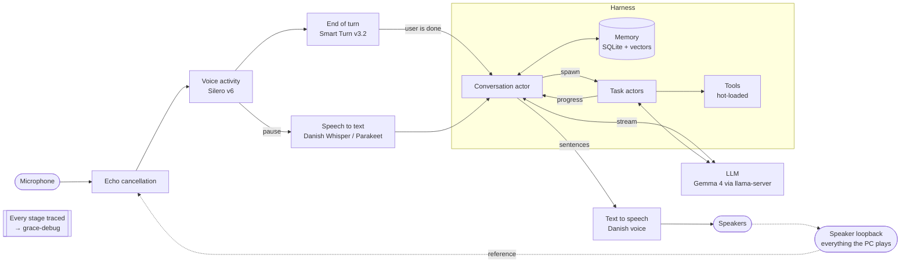

# Grace v2

A voice assistant that runs 100 % locally on my own laptop. You talk to her in Danish (or
English) through the speakers, she answers out loud almost instantly, and you can interrupt her.
She remembers, and she can use tools on the PC. No cloud AI.

This is a ground-up rebuild. [Grace v1](https://github.com/MikkelBlom/project-grace) proved the
parts worked but never felt usable day to day; [the lessons](docs/LESSONS-FROM-V1.md) shaped
this version.

**Status:** v0.0, foundation. Tracing, the debug viewer, the turn-taking core and the model
bake-off harness exist; there is no live voice loop yet. See the [roadmap](docs/ROADMAP.md).

## Goals
- **Near-instant replies.** Target under 800 ms from the end of your sentence to her first word.
- **Speakers, not a headset.** She ignores her own voice and anything the PC plays (YouTube,
  Spotify), but anyone in the room can talk to her.
- **Talk while she works.** Longer tasks run in the background; she tells you what she's doing
  and comes back with the answer.
- **Memory as a source of truth** about herself, you, how to act and your PC, which updates when
  facts change.
- **Light enough to keep running** next to dev servers, databases and VMs.
- **Changes without restarts.** Prompts, personality and tools reload live.

## How it works



Speech is transcribed *while* the turn-end model decides whether you're done, and the reply is
spoken sentence by sentence as the LLM streams it. If you start talking while she speaks, her
voice ducks; keep talking and she stops.

The system is split by how often each part changes ([ADR 0002](docs/adr/0002-process-split-and-hot-reload.md)):
the LLM server and the audio engine hold the models and rarely restart; the harness (turn
logic, memory, tools) restarts in under a second; prompts and tools are files that reload live.

Every model slot is chosen by bake-off on this machine, not from leaderboards. Current picks and
measurements: [docs/MODELS.md](docs/MODELS.md). Design decisions: [docs/adr](docs/adr/).

## Repository

| Path | What |
|---|---|
| `crates/grace-core` | Pure logic, no IO: the turn-taking state machine |
| `crates/grace-trace` | Non-blocking JSONL tracing used by every process |
| `crates/grace-debug` | Live per-turn latency waterfall at `http://127.0.0.1:7700` |
| `crates/grace-bench` | Model bake-off harness (STT, TTS, blind listening page) |
| `bench/` | Bench runners (any language, JSON-lines protocol) and fixture scripts |
| `fixtures/` | Test sentences and manifests (audio is recreated by script, never committed) |
| `docs/` | ADRs, roadmap, model register, lessons from v1 |

## Running what exists

Windows 11, Rust stable, NVIDIA GPU for the bench runners, Python 3.12 for the Python runners.

```bash
cargo test --workspace
cargo run -p grace-trace --example demo_turns     # writes synthetic turns to traces/
cargo run -p grace-debug                           # open http://127.0.0.1:7700
```

Bake-offs (see `crates/grace-bench/src/main.rs` and `bench/runners/` for all options):

```bash
python bench/fetch_fixtures.py
cargo run --release -p grace-bench -- stt --manifest fixtures/stt/manifest.jsonl --label edda -- python bench/runners/stt_faster_whisper.py --model danish-foundation-models/edda-v0.2
```

## License

All rights reserved. The source is public to read, not to copy or reuse. See [LICENSE](LICENSE).
